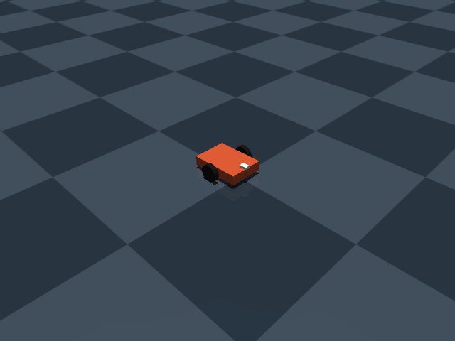
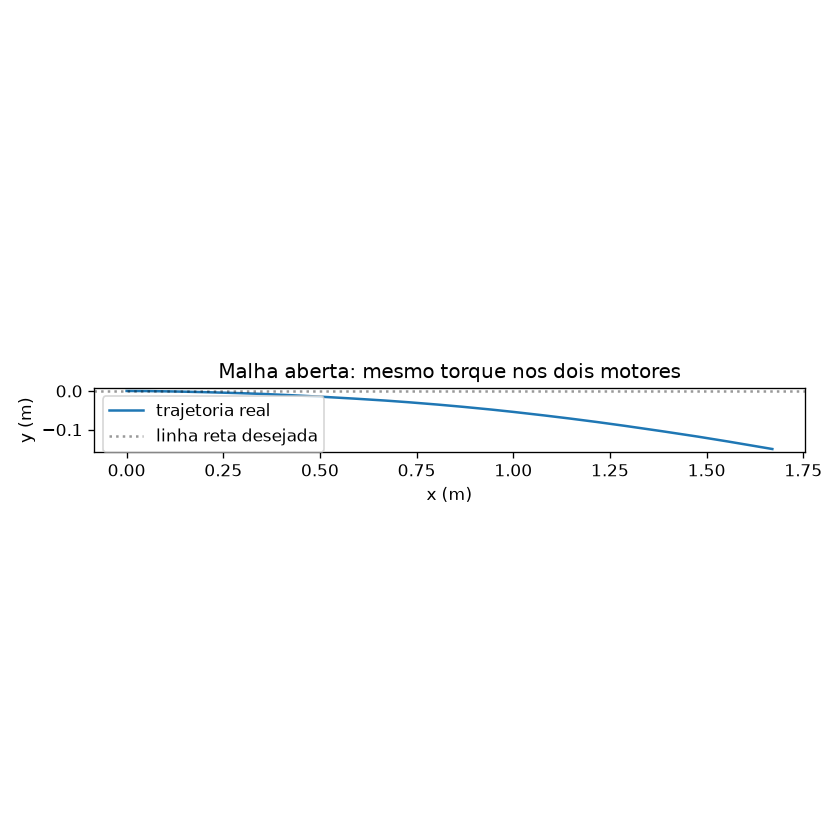
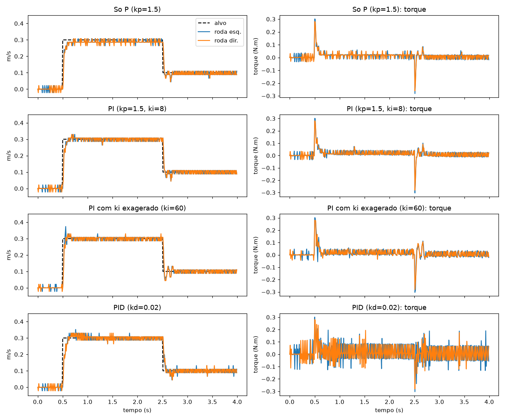
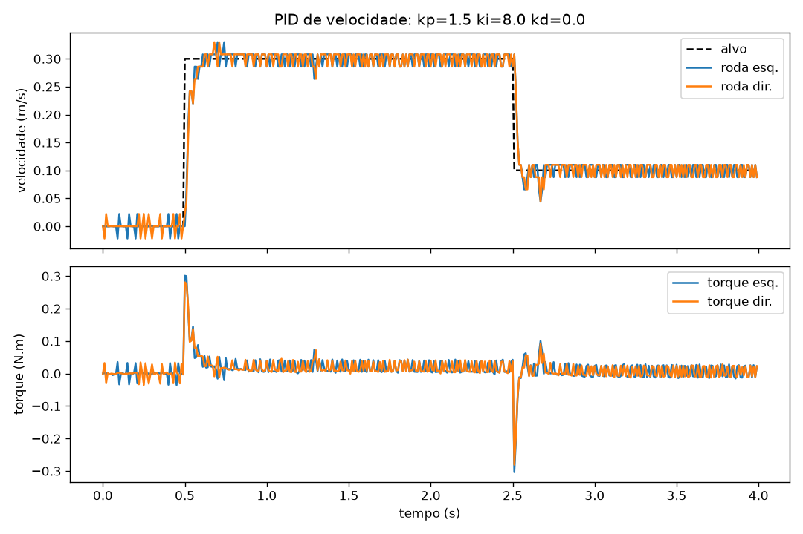
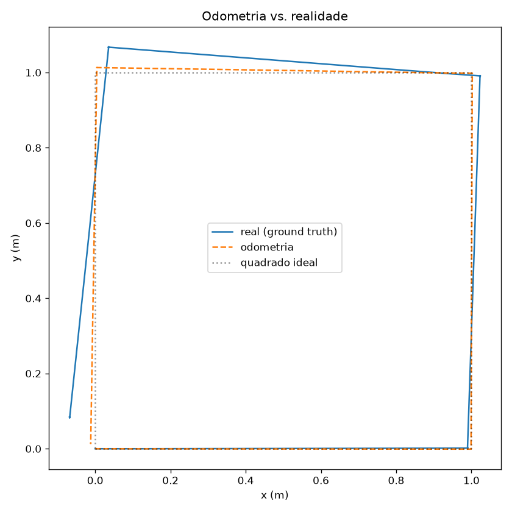

# Lição 01: Robô diferencial, PID e odometria



## Arquivos
| arquivo | o que é |
|---|---|
| `robot.xml` | modelo físico do robô (MJCF, o formato do MuJoCo) |
| `robot.py` | "driver de hardware" simulado: encoders quantizados, torque com ruído, motor direito 7% mais fraco |
| `controllers.py` | PID com anti-windup e odometria |
| `sim.py` | experimentos que geram gráficos |

## Rodando
```bash
source .venv/bin/activate && cd 01-diff-drive   # a partir da raiz do repo
python sim.py openloop    # sem controle: o robô entorta     -> openloop.png
python sim.py compare     # P vs PI vs PID                   -> compare.png
python sim.py pid         # degrau com os ganhos escolhidos  -> pid.png
python sim.py square      # quadrado: odometria vs realidade -> square.png
mjpython sim.py square --view   # qualquer experimento em 3D (no macOS precisa do mjpython)
```

## 1. Cinemática diferencial
Com velocidades das rodas `v_l`, `v_r` e distância entre rodas `L`:
```
v     = (v_r + v_l) / 2     velocidade para frente
omega = (v_r - v_l) / L     velocidade de giro (rad/s)
```
Rodas iguais: anda reto. Rodas opostas: gira no lugar.

## 2. Malha aberta (`openloop`)
Mesmo torque nos dois motores, e o robô termina 15 cm fora da linha depois de 1,7 m. O motivo é que os motores nunca são idênticos (no `robot.py` o direito rende 7% menos). Na vida real também mudam com atrito, temperatura e bateria. Mandar o "mesmo comando" não garante o "mesmo resultado".



## 3. PID (`compare`)
O PID mede a velocidade real pelo encoder e corrige o torque a cada 10 ms.

| config | o que se vê |
|---|---|
| só P | rápido, mas fica um pouco abaixo do alvo: o P só gera torque se houver erro, então algum erro sempre sobra |
| PI (ki=8) | o I acumula esse resíduo e zera o erro. Foi o escolhido |
| PI (ki=60) | integral forte demais: overshoot de 25% e oscilação depois do degrau |
| PID (kd=0.02) | o D deriva um sinal ruidoso (a velocidade vem de ticks quantizados) e o torque vira ruído puro. Em robô real isso esquenta o motor e o driver |

Lições práticas:
- **Controle de velocidade de motor quase sempre é PI.** O D raramente compensa sem filtrar a medição.
- **O "serrilhado" da velocidade é quantização**: a 0,3 m/s a roda gira cerca de 14 ticks a cada 10 ms, então um tick a mais ou a menos já dá 7% de diferença. Mais ticks por volta ou uma janela maior de medição suavizam.
- **Anti-windup**: quando o torque satura (pico no degrau), a integral para de acumular. Sem isso, ela "carrega" durante a saturação e gera overshoot depois.





## 4. Odometria (`square`)
A cada passo: ticks viram metros, metros viram `d_center` e `d_theta`, e a pose é integrada usando o ângulo **médio** do intervalo (o robô girou durante o passo, então o ângulo médio aproxima melhor o arco percorrido). O `theta` é normalizado para `[-pi, pi]`, porque um controlador que compara ângulos precisa saber que 359° e -1° são a mesma direção.

Resultado: a odometria "acha" que fez um quadrado quase perfeito, mas o robô real termina a cerca de 9 cm e 8° de diferença. A maior parte do erro vem dos **giros no lugar**: as rodas escorregam lateralmente ao girar, e esse escorregamento não aparece nos encoders. Por isso todo robô real complementa a odometria com um IMU (giroscópio mede o giro diretamente), câmera ou LiDAR.



## Próxima lição
Controlador go-to-goal: dado um ponto (x, y), o robô usa a odometria para ir até ele sozinho, e a gente vê o erro da odometria virar erro de navegação. Depois, fusão com IMU para reduzir esse erro.
