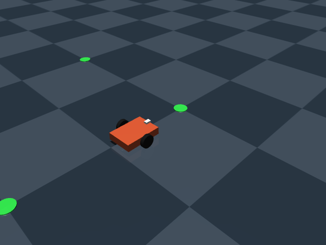
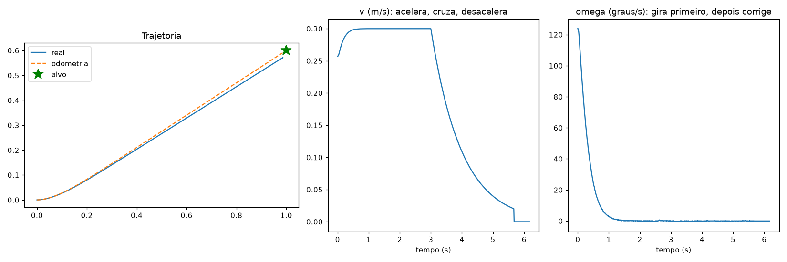
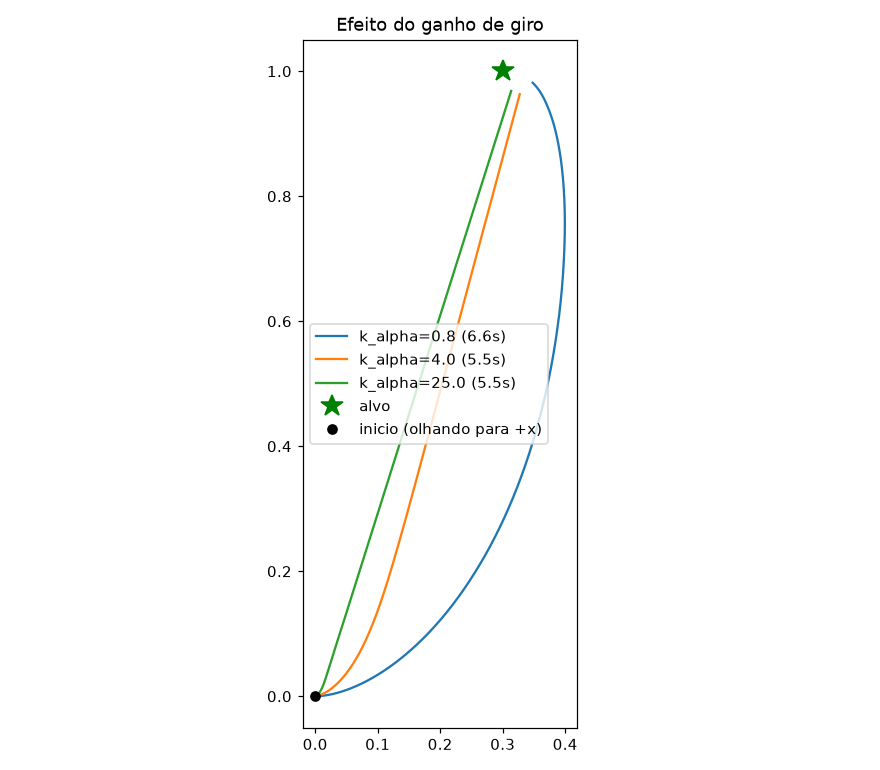
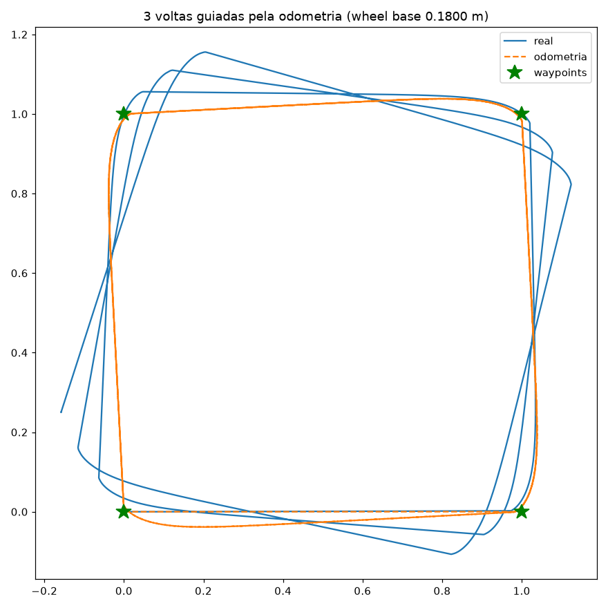
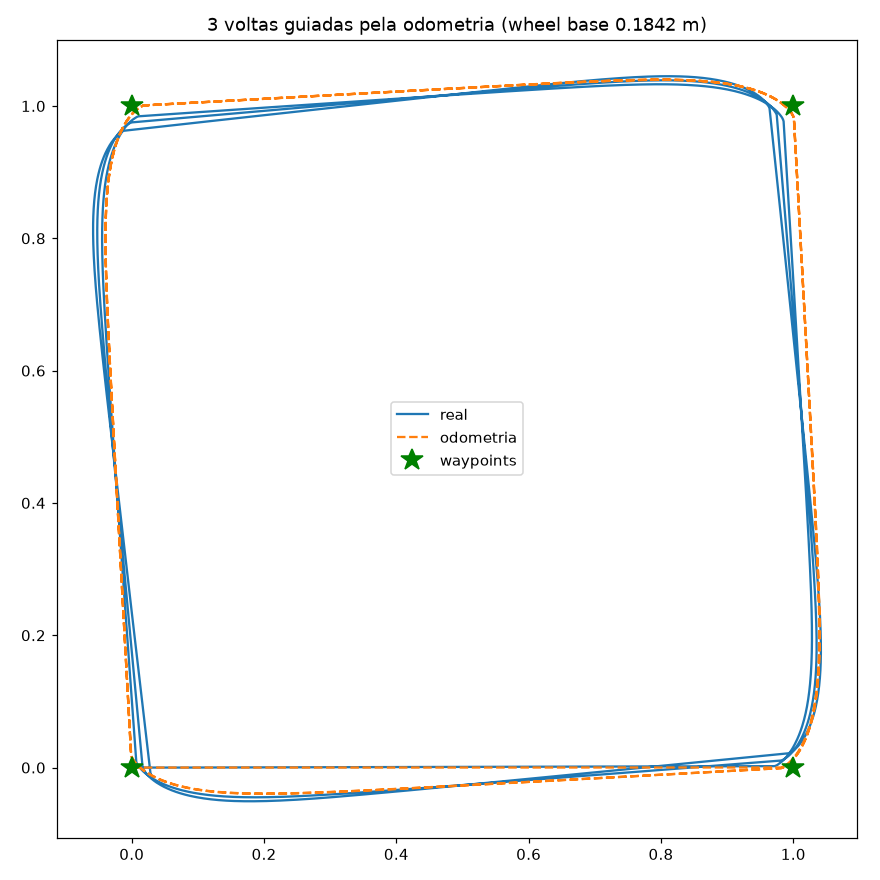

# Lição 02: Go-to-goal

Dado um ponto (x, y), o robô vai até ele sozinho. É o bloco básico de toda navegação: planejadores como o Nav2 (que veremos no ROS 2) geram uma sequência de pontos, e algo parecido com isto segue esses pontos.



## Arquivos
| arquivo | o que é |
|---|---|
| `navigation.py` | controlador go-to-goal e cinemática inversa |
| `sim.py` | experimentos (reaproveita robô, PID e odometria da lição 01) |

## Rodando
```bash
source .venv/bin/activate && cd 02-go-to-goal   # a partir da raiz do repo
python sim.py goal                    # vai até (1.0, 0.6)     -> goal.png
python sim.py goal --x -0.5 --y 0.4   # alvo atrás do robô
python sim.py gains                   # efeito do ganho de giro -> gains.png
python sim.py square                  # 3 voltas num quadrado   -> square.png
mjpython sim.py square --view         # 3D, com os alvos marcados em verde no chão
```

## A pilha de controle
Cada camada só conversa com a de baixo. É a mesma arquitetura de robôs reais e do ROS:
```
GoToGoal            pose + alvo        -> (v, omega)         "para onde ir"
unicycle_to_wheels  (v, omega)         -> (v_esq, v_dir)     cinemática inversa
WheelSpeedController  v_esq, v_dir     -> torques            PID da lição 01
Odometry            ticks              -> pose               fecha o laço
```

## 1. O controlador
Em coordenadas polares, a partir do robô:
- `rho`: distância até o alvo
- `alpha`: ângulo do alvo visto pelo robô (0 significa alvo bem na frente)

```
omega = k_alpha * alpha                                   gira para apontar ao alvo
v     = min(v_max, k_rho * rho) * max(0, cos(alpha))      anda, desacelerando perto do alvo
```
O termo `max(0, cos(alpha))` faz o trabalho pesado: com o alvo de lado (90°) ou atrás, a velocidade é zero e o robô só gira. Conforme ele se alinha, `cos(alpha)` cresce e ele vai acelerando. Por isso, com o alvo atrás (`--x -0.5 --y 0.4`), ele gira no lugar primeiro e depois vai reto.



## 2. Cinemática inversa
O inverso da lição 01:
```
v_esq = v - omega * L / 2
v_dir = v + omega * L / 2
```
Se uma roda passar do limite, as **duas** são escaladas pela mesma proporção. Cortar só a roda que passou mudaria a razão entre elas, e o robô faria uma curva diferente da pedida.

## 3. Ganho de giro (`gains`)
Alvo a 90° para a esquerda:
- `k_alpha=0.8`: gira devagar e faz um arco largo, contornando o alvo (mais lento: 6,6 s)
- `k_alpha=4`: equilíbrio entre girar e andar
- `k_alpha=25`: praticamente "gira primeiro, depois vai reto". Não oscilou porque a saturação das rodas limita o giro, mas num robô real ganhos altos assim amplificam o ruído da pose e fazem o robô "tremer" na direção.



## 4. O problema que sobra (`square`)
O robô segue o quadrado **perfeitamente segundo a odometria** (linha laranja), mas o caminho real (azul) gira um pouco a cada volta:

| volta | distância real da origem ao "voltar para casa" |
|---|---|
| 1 | 10,8 cm |
| 2 | 20,0 cm |
| 3 | 29,7 cm |

O erro cresce cerca de 10 cm por volta e **nunca se corrige sozinho**. O controlador funciona; a pose em que ele confia é que está errada. Um controle perfeito com uma estimativa errada leva o robô, com precisão, ao lugar errado.

Repare também que as quinas da odometria são arredondadas: o robô não para em cada waypoint, já sai em direção ao próximo enquanto ainda gira.



## 5. Diagnóstico: de onde vem o desvio?
Separando o erro de ângulo acumulado em 3 voltas:
- durante os **giros**: -19,8°
- durante as **retas**: -1,0°

Ou seja, 95% do erro vem dos giros, e ele é **sistemático**: o robô sempre gira cerca de 2% a menos do que a odometria calcula.

A causa: cada roda tem 2 cm de largura e toca o chão em dois pontos (bordas interna e externa, a 0,08 m e 0,10 m do centro). Ao girar no lugar, essas duas bordas precisariam percorrer distâncias diferentes, então uma delas arrasta (*wheel scrubbing*). Esse arrasto freia o giro, e o robô se comporta como se as rodas estivessem mais afastadas do que os 0,18 m nominais. Pneus reais fazem exatamente isso, e o efeito muda com o piso.

## 6. Calibração (`calibrate`)
Erro sistemático se corrige com calibração. O procedimento é o mesmo num robô real:
1. Marque a direção inicial no chão com fita.
2. Mande o robô girar 10 voltas segundo a odometria.
3. Meça quanto ele realmente girou (aqui: 9,77 voltas).
4. Como `d_theta = (d_dir - d_esq) / L`, o ângulo é inversamente proporcional a `L`: `L_efetivo = L_nominal * giro_odometria / giro_real` = **0,1842 m**.

```bash
python sim.py calibrate
python sim.py square --wheel-base 0.1842
```

| volta | wheel base nominal (0,18) | calibrado (0,1842) |
|---|---|---|
| 1 | 10,8 cm | 1,2 cm |
| 2 | 20,0 cm | 1,6 cm |
| 3 | 29,7 cm | 3,1 cm |

Dez vezes melhor, mudando um número. Mas o erro ainda cresce devagar (a parte aleatória: ruído, quantização, escorregamento variável), e a calibração só vale para aquele piso. Para isso não há calibração que resolva, só outro sensor.



Para saber mais: o método UMBmark (Borenstein, 1996) faz essa calibração de forma mais completa, separando o erro do wheel base do erro de diâmetro das rodas.

## Próxima lição
Fusão de sensores: adicionar um IMU (giroscópio) simulado e combinar com a odometria. O giroscópio mede o giro diretamente, sem depender das rodas, então não sofre com o scrubbing nem com a mudança de piso. Começa com um filtro complementar simples e depois vamos para o filtro de Kalman.
