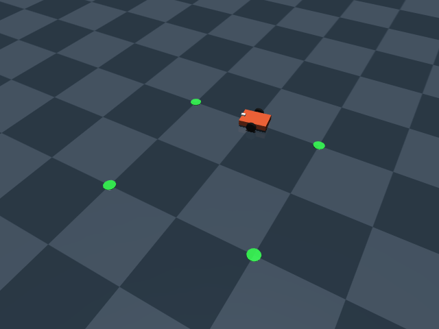
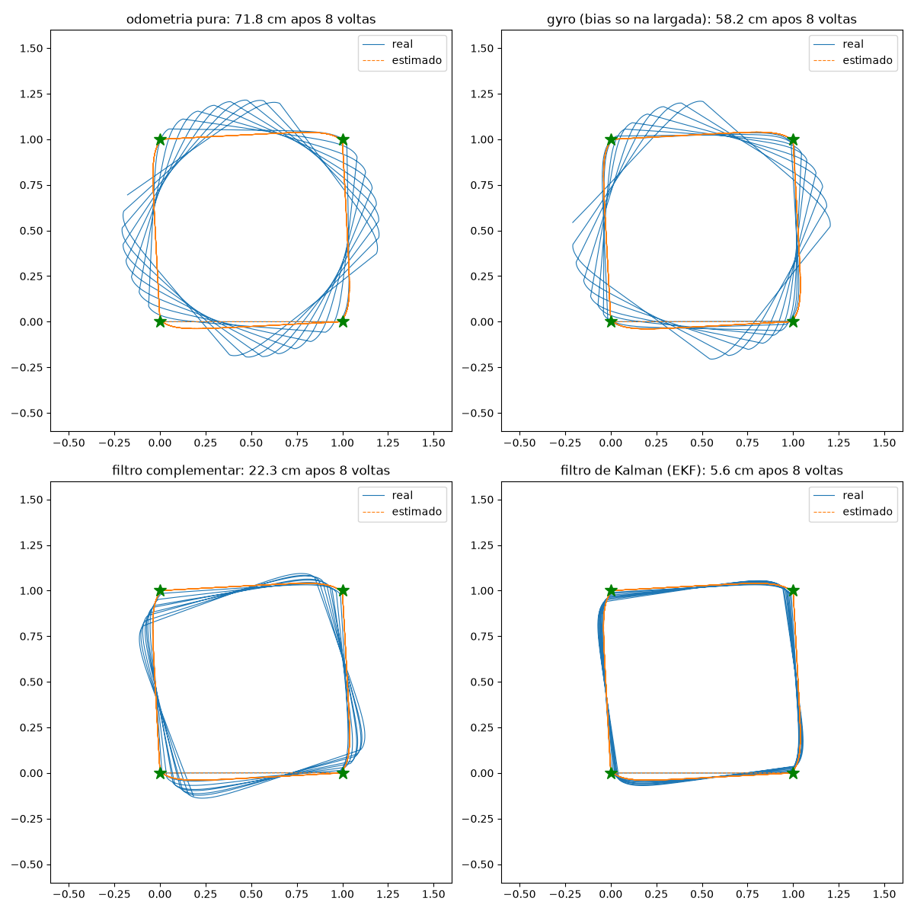
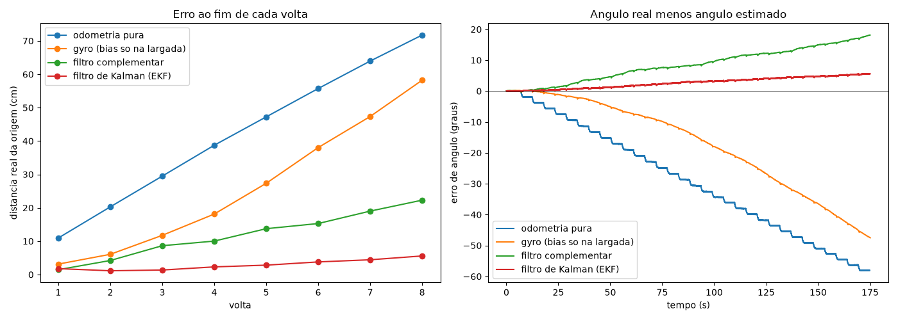
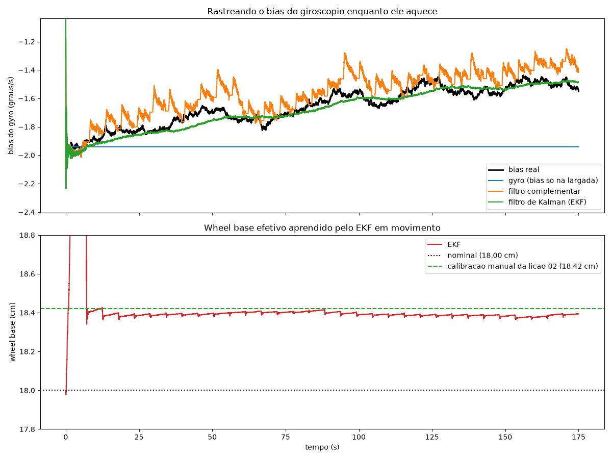

# Lição 03: IMU e fusão de sensores

Na lição 02 o robô se perdia cerca de 10 cm por volta, e a calibração manual do wheel base só resolvia num piso específico. Aqui o robô ganha um giroscópio, e combinamos os dois sensores de jeitos cada vez melhores, até chegar num filtro de Kalman estendido que **calibra o robô sozinho enquanto anda**.



## Arquivos
| arquivo | o que é |
|---|---|
| `estimators.py` | os 4 estimadores de pose: odometria pura, gyro, filtro complementar e EKF |
| `sim.py` | experimentos (reaproveita robô e PID da lição 01 e o go-to-goal da lição 02) |
| `../01-diff-drive/robot.py` | ganhou `read_gyro()`: giroscópio com os defeitos de um MEMS barato |

## Rodando
A partir da raiz do repositório, com o venv ativo:
```bash
cd 03-imu-fusion
python sim.py compare                            # 4 estimadores, 8 voltas cada -> trajectories.png, errors.png, bias.png
python sim.py drive --estimator kalman           # um estimador só (odom, gyro, complementary, kalman)
mjpython sim.py drive --estimator gyro --view    # em 3D
```

## 1. O sensor: giroscópio MEMS
Um giroscópio mede a **velocidade de giro** (rad/s) diretamente, sem depender das rodas. Então ele não sofre com scrubbing, patinagem ou tipo de piso. Mas um MEMS barato (tipo MPU6050) tem os seus próprios defeitos, todos simulados no `robot.py`:

| defeito | valor simulado | efeito |
|---|---|---|
| ruído branco | ~0,35°/s por leitura | pequeno, a integração média |
| **bias** (offset) | ~2°/s, muda a cada vez que liga | parado, ele diz que está girando 2°/s. Integrando: 120° por minuto! |
| deriva térmica do bias | +0,4°/s enquanto o chip aquece (constante de 60 s) | o bias medido no boot deixa de valer |
| random walk do bias | lento e aleatório | idem, sem padrão |

**O bias é o inimigo.** Ruído se cancela na média; bias integrado vira erro de ângulo que cresce para sempre.

## 2. Os 4 estimadores
Todos estimam a posição do mesmo jeito (distância pelos encoders). O que muda é **de onde vem o giro** a cada passo:

### Odometria pura
O giro vem das rodas, como na lição 02, com o wheel base nominal (sem calibração).

### Gyro com bias medido na largada
O robô fica 1,5 s parado no boot. Parado, tudo o que o gyro mede é bias, então a média dessas leituras é o bias. Depois disso o giro vem só do gyro: `d_theta = (gyro - bias) * dt`.

Detalhe prático que apareceu no desenvolvimento: a primeira versão detectava "parado" pelo encoder e só pegava **uma** amostra, porque o robô assenta no chão no primeiro instante e a roda mexe um tick. Robôs reais calibram por tempo fixo no boot pelo mesmo motivo.

### Filtro complementar
Gyro, mais uma correção contínua do bias usando as rodas:
```python
if abs(omega_rodas) < 0.15:            # rodas dizem: indo reto ou parado
    bias_medido = gyro - omega_rodas   # a diferença é quase toda bias
    bias += 0.003 * (bias_medido - bias)
```
Indo reto, as rodas são confiáveis para dizer "não estou girando", e o gyro serve para os giros, onde as rodas falham. Cada sensor cobre a fraqueza do outro. O ganho `0.003` é fixo e escolhido na mão.

### Filtro de Kalman estendido (EKF)
Estado: `[theta, bias do gyro, escala das rodas]`.
```
Predição (gyro):  theta <- theta + (gyro - bias) * dt      e as incertezas crescem
Medição (rodas):  omega_rodas = escala * (gyro - bias) + ruído
```
A cada passo o filtro compara o giro que as rodas mediram com o que o gyro previu. A diferença (*inovação*) é distribuída entre theta, bias e escala, conforme **o quanto ele está incerto sobre cada um** (a matriz de covariância `P`). Esse é o ganho de Kalman `K`: no complementar o ganho é fixo e escolhido na mão; aqui ele é calculado a cada passo.

**Por que a escala no estado?** A primeira versão tinha só `[theta, bias]` e perdia para o filtro complementar. O motivo: o erro das rodas nos giros (os 2% do scrubbing da lição 02) é **sistemático**, e o Kalman supõe ruído aleatório. Ele interpretava esse erro como bias e errava o bias depois de cada giro. Colocando a escala no estado, o próprio filtro estima esse erro:
- **indo reto** (giro real perto de zero): a diferença entre gyro e rodas revela o **bias**
- **girando**: a razão entre rodas e gyro revela a **escala**, ou seja, o wheel base efetivo

A medição `escala * (gyro - bias)` é não linear (produto de dois estados), por isso é um Kalman **estendido**: a cada passo ele lineariza usando o Jacobiano `H = [0, -escala, gyro - bias]`.

## 3. Resultados
8 voltas no quadrado de 1 m (~3 minutos, tempo para o gyro aquecer), wheel base **nominal** para todos:



| estimador | erro após 1 volta | após 8 voltas |
|---|---|---|
| odometria pura | 11,0 cm | 71,8 cm |
| gyro (bias só na largada) | 3,1 cm | 58,2 cm |
| filtro complementar | 1,5 cm | 22,3 cm |
| **EKF** | **1,8 cm** | **5,6 cm** |



Repare no formato do erro de ângulo (direita):
- **odometria**: degraus, um a cada giro (scrubbing), constante entre eles
- **gyro**: curva que acelera. O bias real muda enquanto o chip aquece, e o estimado ficou parado no valor do boot. Ótimo no começo, pior que a odometria no final
- **complementar**: rastreia o bias, mas com atraso e saltos depois de cada giro
- **EKF**: quase plano

Testei 5 sementes aleatórias diferentes (bias com outro sinal, outros ruídos) e o EKF ficou entre 3,4 e 5,6 cm em todas.

## 4. O que os filtros aprendem


**Em cima:** o bias real (preto) sobe enquanto o chip aquece. O gyro simples fica parado no valor do boot. O complementar segue, mas com "dentes" a cada giro. O EKF segue suave e perto do real (erro final de 0,03 a 0,15°/s nas 5 sementes).

**Embaixo:** o wheel base que o EKF aprendeu sozinho, em movimento: **18,39 a 18,40 cm**, praticamente o mesmo valor da calibração manual da lição 02 (18,42 cm), que precisou de fita no chão e 10 voltas paradas.

Nos primeiros ~7 segundos a estimativa dispara. Isso é **observabilidade**: antes do primeiro giro não existe informação sobre a escala (sem giro, não dá para medir a razão entre rodas e gyro), e o filtro ainda nem sabe o bias direito. No primeiro giro ela converge e fica estável.

## 5. O que levar desta lição
- **Fusão de sensores** funciona porque cada sensor erra de um jeito diferente: rodas erram nos giros, gyro erra com o tempo.
- **Erro sistemático não é ruído.** Um Kalman com modelo incompleto pode perder para um filtro mais simples. A solução é estimar o erro sistemático como parte do estado.
- **Observabilidade**: um estado só pode ser estimado se algum movimento o revela. A escala precisa de giros, o bias precisa de retas.
- O que sobra (5,6 cm após 8 voltas) ainda cresce devagar. O ângulo em si nunca é medido diretamente, só a sua variação. Para zerar de vez é preciso uma **referência absoluta**: um marcador visual, um mapa com LiDAR, uma bússola. Isso é localização e SLAM, que vem junto com o ROS 2.

## Próxima lição
ROS 2 com Gazebo: levar esta pilha (PID, odometria, fusão, navegação) para a arquitetura que robôs reais usam, com nodes, tópicos, TF2 e, depois, SLAM e Nav2.
