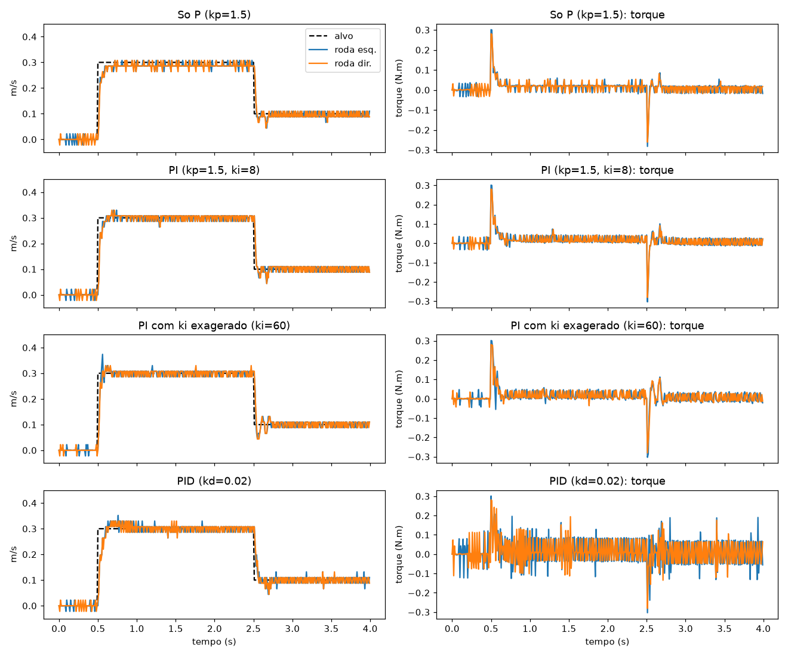
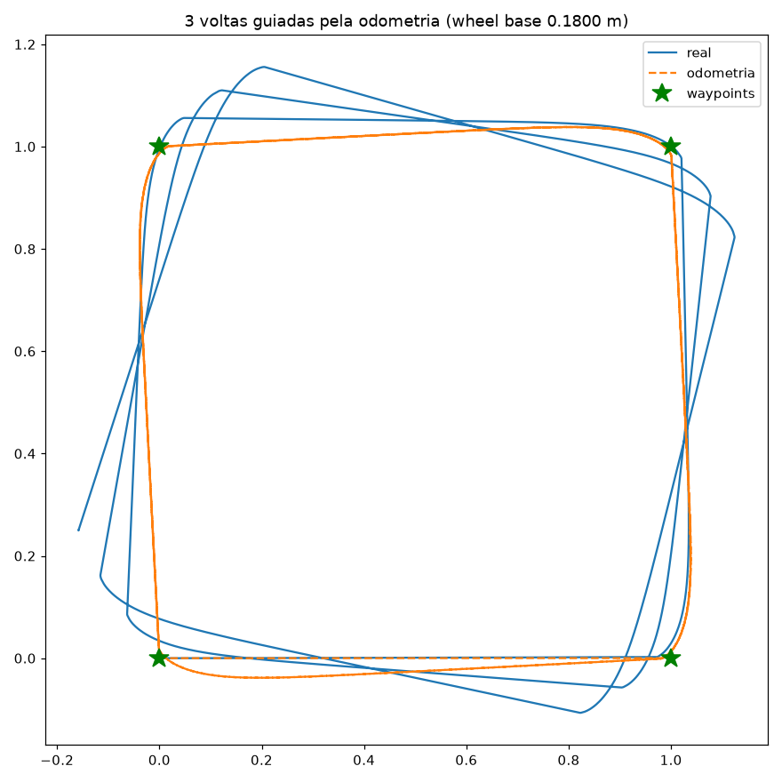
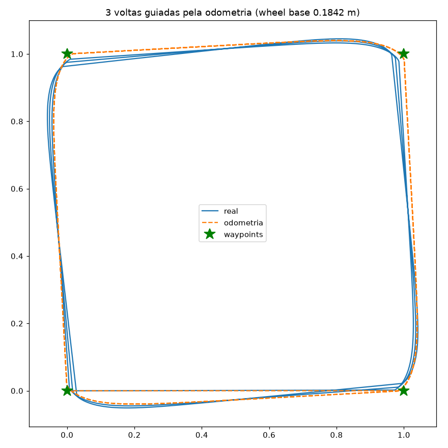

# Robótica: do PID às redes neurais

Trilha de estudo prático de robótica, feita lição por lição em simulação física com [MuJoCo](https://mujoco.org). Começa pelo básico (controle de motores, odometria, navegação) e caminha em direção a redes neurais e IA aplicada a robôs. Cada lição tem código rodável, experimentos que geram gráficos e um README explicando a teoria e os resultados.

## Setup
```bash
python3 -m venv .venv
source .venv/bin/activate
pip install -r requirements.txt
```
Cada lição roda com `python sim.py <experimento>` dentro da pasta dela. Para abrir o viewer 3D no macOS, use `mjpython` no lugar de `python` (vem junto com o pacote `mujoco`) e passe `--view`.

## Lições
| # | lição | o que tem |
|---|---|---|
| 01 | [Robô diferencial, PID e odometria](01-diff-drive/) | cinemática diferencial, PID de velocidade com anti-windup, odometria por encoders<br> |
| 02 | [Go-to-goal e calibração de odometria](02-go-to-goal/) | navegação ponto a ponto, cinemática inversa, diagnóstico do drift e calibração do wheel base (erro de 30 cm para 3 cm)<br>  |

## Próximas
- Fusão de sensores: IMU + odometria (filtro complementar e filtro de Kalman)
- ROS 2 + Gazebo: URDF, TF2, SLAM, Nav2
- Percepção com redes neurais: PyTorch, detecção de objetos (YOLO) integrada à navegação
- Aprendizado por reforço: MuJoCo, Stable-Baselines3, PPO implementado do zero
- Imitation learning e VLAs: LeRobot, políticas treinadas com demonstrações, comandos em linguagem natural
